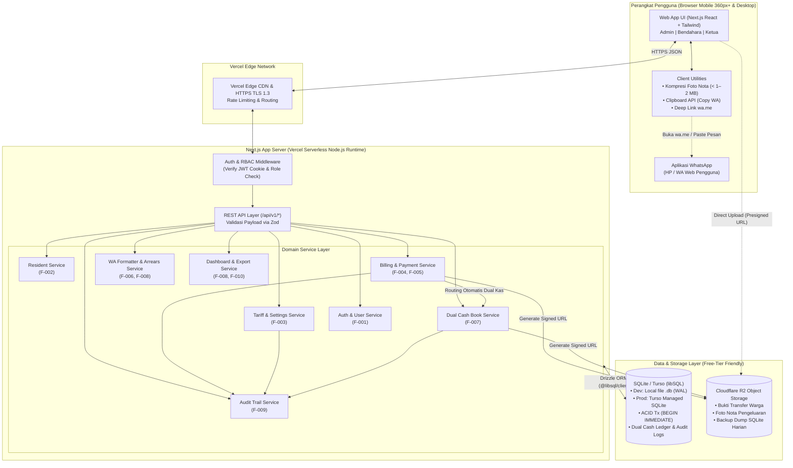
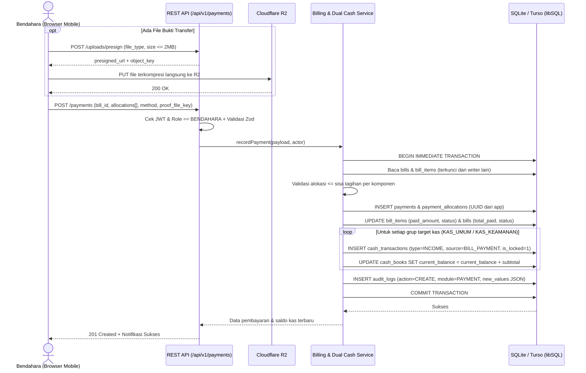
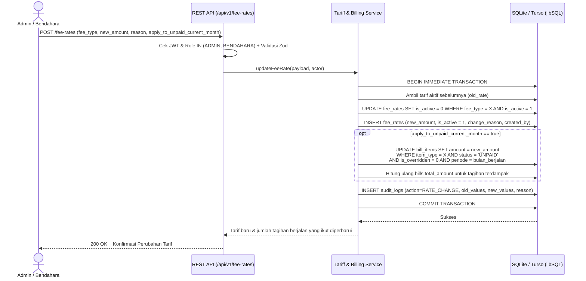

# Rancangan Arsitektur Sistem — Aplikasi Manajemen RT/RW

| Informasi Dokumen | Detail |
| :--- | :--- |
| **Proyek** | Aplikasi Manajemen RT/RW (Web Mobile-Responsive) |
| **Gaya Arsitektur** | Modular Fullstack Monolith (Serverless Vercel + SQLite/Turso) |
| **Fase** | Fase 2 — Senior Technology Architect (Revisi Database SQLite) |
| **Referensi Fitur** | `F-001` s/d `F-010` (`03-function-list-aplikasi-rtrw.md`) |

---

## 1. Diagram Arsitektur Sistem (Container & Integrasi)

Diagram berikut menggambarkan komponen utama sistem yang dirancang ringan dan dapat di-deploy 100% gratis di Vercel + Turso (SQLite) + Cloudflare R2.

---

## 2. Penjelasan Lapisan Arsitektur dan Tanggung Jawab

### 2.1 Client Layer (Web Mobile-Responsive)
* **Antarmuka Adaptif:** Menggunakan navigasi *bottom bar* di perangkat mobile (`< 768px`) agar mudah dioperasikan satu tangan oleh Bendahara dan Ketua, serta *sidebar* di desktop (`>= 768px`) untuk Admin.
* **Client-Side Image Compression & Direct Upload:** Foto bukti transfer (`F-005`) atau nota pengeluaran (`F-007`) diperkecil otomatis di browser (< 1–2 MB), lalu diunggah langsung ke **Cloudflare R2** menggunakan *Presigned URL* dari backend. Pendekatan ini menghindari batas ukuran body request (4,5 MB) pada Vercel Serverless sekaligus menghemat bandwidth server.
* **Integrasi WhatsApp Gratis (`F-006`, `F-008`):** Pesan penagihan dan laporan kas diformat secara konsisten oleh backend berdasarkan template di SQLite, lalu diserahkan ke frontend untuk disalin via `Clipboard API` (dengan *fallback* manual) atau dibuka via `https://wa.me/628xxx?text=...`.

### 2.2 Vercel Edge & Security Middleware
* **HTTPS Otomatis & Proteksi Akses:** Seluruh lalu lintas terenkripsi TLS 1.3 bawaan Vercel.
* **RBAC Middleware (`F-001`):** Setiap request ke `/api/v1/*` (kecuali `/auth/login`) memverifikasi HTTP-only JWT Cookie, mengekstrak `user_id` dan `role`, lalu mencocokkannya dengan izin endpoint. Akses tidak sah langsung ditolak dengan `403 Forbidden`.

### 2.3 Domain Service Layer (Modular Monolith)
* **Billing & Payment Service (`F-004`, `F-005`):** Mengelola generate tagihan bulanan idempoten (`INSERT ... ON CONFLICT DO NOTHING`), input Denda Ronda, override nominal, serta alokasi pembayaran parsial/lunas.
* **Dual Cash Book Service (`F-007`):** Menjaga pemisahan mutlak antara `KAS_UMUM` dan `KAS_KEAMANAN`. Karena menggunakan **SQLite**, penguncian tulis atomik dilakukan menggunakan transaksi **`BEGIN IMMEDIATE`** (bukan `SELECT ... FOR UPDATE`), yang secara alami menyerialisasi penulisan saldo kas sehingga bebas dari *race condition*.
* **Audit Trail Service (`F-009`):** Dipanggil di dalam transaksi `BEGIN IMMEDIATE` yang sama setiap kali ada perubahan tarif (`F-003`), override tagihan (`F-004`), pembayaran/pembatalan (`F-005`), atau mutasi kas manual (`F-007`). Jika pencatatan log gagal, seluruh transaksi di-*rollback*.

---

## 3. Alur Data Kritis (Sequence Diagrams)

### 3.1 Alur Pembayaran per Komponen & Routing Otomatis Dual Kas (`F-005`, `F-007`, `F-009`)

Alur ini memastikan pembayaran warga (lunas maupun cicilan per komponen) masuk secara akurat ke `KAS_UMUM` dan/atau `KAS_KEAMANAN` dalam satu transaksi atomik SQLite (`BEGIN IMMEDIATE`).

### 3.2 Alur Perubahan Tarif Dinamis + Audit Trail (`F-003`, `F-004`, `F-009`)

Alur ini menjamin tarif Iuran Wajib, Iuran Keamanan, dan Denda Ronda dapat diubah kapan saja oleh **Admin** atau **Bendahara** tanpa merusak tagihan historis yang sudah lunas.

---

## 4. Strategi Penanganan Pembatalan (Void) & Integritas Saldo

* **Pembatalan Pembayaran (`F-005`):** Tidak ada penghapusan permanen (*hard delete*) untuk transaksi keuangan. Aksi pembatalan dijalankan dalam transaksi `BEGIN IMMEDIATE` untuk mengubah `payments.status = 'VOIDED'` (wajib `void_reason`), menandai `cash_transactions` terkait menjadi `'VOIDED'`, mengembalikan `cash_books.current_balance`, menghitung ulang `bill_items` & `bills`, serta mencatat jejaknya di `audit_logs`.
* **Rekonsiliasi Saldo:** Saldo cepat dibaca dari `cash_books.current_balance`, dilengkapi fungsi verifikasi konsistensi (`SUM(INCOME) - SUM(EXPENSE)` pada baris berstatus `'POSTED'`) untuk memastikan selisih selalu Rp 0 (`BIZ-04`).