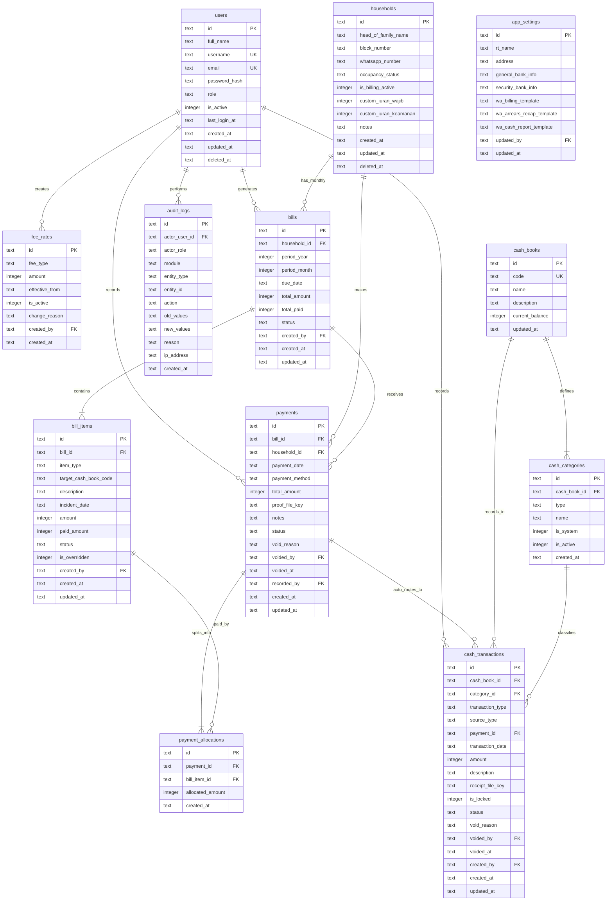

# Schema Database dan ERD — Aplikasi Manajemen RT/RW

| Informasi Dokumen | Detail |
| :--- | :--- |
| **Proyek** | Aplikasi Manajemen RT/RW (Web Mobile-Responsive, Single RT/Komplek) |
| **DBMS Target** | **SQLite 3 / Turso (libSQL)** *(Dev: file lokal `.db`; Prod Vercel: Turso Managed SQLite)* |
| **Konvensi Tipe Data SQLite** | `snake_case`; PK `TEXT` (UUIDv4 dibuat di app layer); Nominal Rupiah `INTEGER` (64-bit signed); Boolean `INTEGER` (`0`/`1`); Tanggal `TEXT` (`YYYY-MM-DD`); Timestamp `TEXT` (ISO-8601 UTC); JSON `TEXT` (`json_valid`) |
| **Fase** | Fase 2 — Senior Technology Architect (Revisi Database SQLite) |
| **Referensi Fitur** | `F-001` s/d `F-010` (`03-function-list-aplikasi-rtrw.md`) |

---

## 1. Entity Relationship Diagram (ERD)

---

## 2. Catatan Konfigurasi Wajib SQLite / libSQL

Sebelum menjalankan query atau migrasi pada SQLite, aturan berikut wajib diterapkan pada klien database (`@libsql/client` + Drizzle ORM):

1. **Foreign Key Enforcement:** Jalankan `PRAGMA foreign_keys = ON;` pada inisialisasi koneksi (aktif secara default di Turso, namun wajib dipastikan saat development dengan file `.db` lokal).
2. **Mode WAL (Lokal/VPS):** Untuk file lokal `.db`, aktifkan `PRAGMA journal_mode = WAL;` dan `PRAGMA busy_timeout = 5000;` agar operasi baca tidak terblokir saat ada penulisan.
3. **Transaksi Keuangan:** Seluruh mutasi saldo kas dan pembayaran tagihan wajib dibungkus dalam transaksi **`BEGIN IMMEDIATE`** untuk mencegah *race condition* antar permintaan bersamaan.
4. **Standar Timestamp & UUID:** Nilai `id` (UUIDv4) di-generate pada sisi aplikasi (`crypto.randomUUID()`) dan timestamp default menggunakan format ISO-8601 UTC (`strftime('%Y-%m-%dT%H:%M:%fZ', 'now')`) agar pengurutan teks (`ORDER BY created_at DESC`) selalu akurat.

---

## 3. Spesifikasi Detail Tabel (SQLite)

### 3.1 `users` — Akun Pengurus & RBAC (`F-001`)

| Kolom | Tipe SQLite | Constraint | Keterangan |
| :--- | :--- | :--- | :--- |
| `id` | `TEXT` | `PRIMARY KEY` | UUIDv4 dari application layer |
| `full_name` | `TEXT` | `NOT NULL` | Nama lengkap pengurus |
| `username` | `TEXT` | `UNIQUE, NOT NULL` | Username login |
| `email` | `TEXT` | `UNIQUE, NOT NULL` | Email pengurus |
| `password_hash` | `TEXT` | `NOT NULL` | Hash bcrypt / Argon2id |
| `role` | `TEXT` | `NOT NULL, CHECK (role IN ('ADMIN','BENDAHARA','KETUA'))` | Role RBAC |
| `is_active` | `INTEGER` | `NOT NULL, DEFAULT 1, CHECK (is_active IN (0,1))` | `1` = aktif, `0` = nonaktif |
| `last_login_at` | `TEXT` | `NULL` | ISO-8601 UTC waktu login terakhir |
| `created_at` / `updated_at` | `TEXT` | `NOT NULL, DEFAULT (strftime('%Y-%m-%dT%H:%M:%fZ','now'))` | Timestamp audit standar |
| `deleted_at` | `TEXT` | `NULL` | Soft delete akun |

### 3.2 `app_settings` — Konfigurasi RT, Rekening & Template WA (`F-003`, `F-006`, `F-008`)

| Kolom | Tipe SQLite | Constraint | Keterangan |
| :--- | :--- | :--- | :--- |
| `id` | `TEXT` | `PRIMARY KEY` | Baris konfigurasi tunggal (misal `'default'`) |
| `rt_name` | `TEXT` | `NOT NULL` | Nama lingkungan (misal: RT 04 / RW 02 Komplek Melati) |
| `address` | `TEXT` | `NULL` | Alamat sekretariat |
| `general_bank_info` | `TEXT` | `NULL` | Info rekening/e-wallet Kas Umum |
| `security_bank_info` | `TEXT` | `NULL` | Info rekening/e-wallet Kas Keamanan (opsional jika beda) |
| `wa_billing_template` | `TEXT` | `NOT NULL` | Template pesan WA Penagihan Personal |
| `wa_arrears_recap_template` | `TEXT` | `NOT NULL` | Template pesan WA Rekap Daftar Belum Bayar |
| `wa_cash_report_template` | `TEXT` | `NOT NULL` | Template pesan WA Laporan Dual Kas Bulanan |
| `updated_by` | `TEXT` | `REFERENCES users(id)` | Pengurus terakhir yang mengubah |
| `updated_at` | `TEXT` | `NOT NULL, DEFAULT (strftime('%Y-%m-%dT%H:%M:%fZ','now'))` | Waktu pembaruan terakhir |

### 3.3 `fee_rates` — Tarif Iuran & Denda Dinamis Berversi (`F-003`, `F-004`)

| Kolom | Tipe SQLite | Constraint | Keterangan |
| :--- | :--- | :--- | :--- |
| `id` | `TEXT` | `PRIMARY KEY` | UUID versi tarif |
| `fee_type` | `TEXT` | `NOT NULL, CHECK (fee_type IN ('IURAN_WAJIB','IURAN_KEAMANAN','DENDA_RONDA'))` | Jenis tarif |
| `amount` | `INTEGER` | `NOT NULL, CHECK (amount >= 0)` | Nominal tarif dalam Rupiah penuh |
| `effective_from` | `TEXT` | `NOT NULL` | Tanggal mulai berlaku (`YYYY-MM-DD`) |
| `is_active` | `INTEGER` | `NOT NULL, DEFAULT 1, CHECK (is_active IN (0,1))` | `1` = tarif aktif saat ini |
| `change_reason` | `TEXT` | `NULL` | Alasan penyesuaian tarif (misal: Hasil Rapat Warga) |
| `created_by` | `TEXT` | `NOT NULL, REFERENCES users(id)` | Admin/Bendahara yang menetapkan tarif |
| `created_at` | `TEXT` | `NOT NULL, DEFAULT (strftime('%Y-%m-%dT%H:%M:%fZ','now'))` | Waktu pencatatan tarif |

*Constraint khusus:* Partial Unique Index `ux_fee_rates_active_type ON fee_rates(fee_type) WHERE is_active = 1` (didukung penuh oleh SQLite 3.8+) memastikan selalu tepat satu tarif aktif untuk masing-masing jenis iuran/denda.

### 3.4 `households` — Data Warga / KK / Rumah (`F-002`)

| Kolom | Tipe SQLite | Constraint | Keterangan |
| :--- | :--- | :--- | :--- |
| `id` | `TEXT` | `PRIMARY KEY` | UUID KK/unit rumah |
| `head_of_family_name` | `TEXT` | `NOT NULL` | Nama Kepala Keluarga |
| `block_number` | `TEXT` | `NOT NULL` | Blok/Nomor Rumah (unik untuk baris aktif via partial index) |
| `whatsapp_number` | `TEXT` | `NOT NULL` | Nomor WA dinormalisasi ke format `628xxx` |
| `occupancy_status` | `TEXT` | `NOT NULL, CHECK (occupancy_status IN ('TETAP','KONTRAK','KOSONG'))` | Status hunian rumah |
| `is_billing_active` | `INTEGER` | `NOT NULL, DEFAULT 1, CHECK (is_billing_active IN (0,1))` | `1` = ikut serta generate tagihan bulanan |
| `custom_iuran_wajib` | `INTEGER` | `NULL, CHECK (custom_iuran_wajib IS NULL OR custom_iuran_wajib >= 0)` | Override tarif Iuran Wajib khusus KK (`NULL` = pakai tarif global) |
| `custom_iuran_keamanan` | `INTEGER` | `NULL, CHECK (custom_iuran_keamanan IS NULL OR custom_iuran_keamanan >= 0)` | Override tarif Iuran Keamanan khusus KK (`NULL` = pakai tarif global) |
| `notes` | `TEXT` | `NULL` | Catatan tambahan (misal: keringanan iuran) |
| `created_at` / `updated_at` | `TEXT` | `NOT NULL, DEFAULT (strftime('%Y-%m-%dT%H:%M:%fZ','now'))` | Timestamp audit standar |
| `deleted_at` | `TEXT` | `NULL` | Soft delete (warga pindah tetap menjaga histori) |

### 3.5 `bills` — Header Tagihan Bulanan per KK (`F-004`, `F-005`, `F-006`)

| Kolom | Tipe SQLite | Constraint | Keterangan |
| :--- | :--- | :--- | :--- |
| `id` | `TEXT` | `PRIMARY KEY` | UUID tagihan bulanan |
| `household_id` | `TEXT` | `NOT NULL, REFERENCES households(id)` | Referensi KK/rumah |
| `period_year` | `INTEGER` | `NOT NULL, CHECK (period_year BETWEEN 2020 AND 2100)` | Tahun periode tagihan |
| `period_month` | `INTEGER` | `NOT NULL, CHECK (period_month BETWEEN 1 AND 12)` | Bulan periode tagihan (1–12) |
| `due_date` | `TEXT` | `NOT NULL` | Tanggal jatuh tempo (`YYYY-MM-DD`) |
| `total_amount` | `INTEGER` | `NOT NULL, CHECK (total_amount >= 0)` | Total seluruh `bill_items.amount` |
| `total_paid` | `INTEGER` | `NOT NULL, DEFAULT 0, CHECK (total_paid >= 0 AND total_paid <= total_amount)` | Total nominal yang sudah dibayar |
| `status` | `TEXT` | `NOT NULL, CHECK (status IN ('UNPAID','PARTIAL','PAID'))` | Status kelunasan tagihan |
| `created_by` | `TEXT` | `NOT NULL, REFERENCES users(id)` | Pembuat / pemicu generate tagihan |
| `created_at` / `updated_at` | `TEXT` | `NOT NULL, DEFAULT (strftime('%Y-%m-%dT%H:%M:%fZ','now'))` | Timestamp |

*Constraint khusus:* `UNIQUE (household_id, period_year, period_month)` menjamin *idempotency* tombol Generate Tagihan Bulanan (`F-004`).

### 3.6 `bill_items` — Rincian Komponen Tagihan & Denda Ronda (`F-004`, `F-005`)

| Kolom | Tipe SQLite | Constraint | Keterangan |
| :--- | :--- | :--- | :--- |
| `id` | `TEXT` | `PRIMARY KEY` | UUID rincian komponen |
| `bill_id` | `TEXT` | `NOT NULL, REFERENCES bills(id) ON DELETE CASCADE` | Header tagihan |
| `item_type` | `TEXT` | `NOT NULL, CHECK (item_type IN ('IURAN_WAJIB','IURAN_KEAMANAN','DENDA_RONDA'))` | Jenis komponen tagihan |
| `target_cash_book_code` | `TEXT` | `NOT NULL, CHECK (target_cash_book_code IN ('KAS_UMUM','KAS_KEAMANAN'))` | Target routing kas (`IURAN_WAJIB` -> `KAS_UMUM`; `IURAN_KEAMANAN` & `DENDA_RONDA` -> `KAS_KEAMANAN`) |
| `description` | `TEXT` | `NOT NULL` | Keterangan komponen (misal: Denda Absen Ronda 12 Nov) |
| `incident_date` | `TEXT` | `NULL` | Tanggal ketidakhadiran ronda (`YYYY-MM-DD`, khusus `DENDA_RONDA`) |
| `amount` | `INTEGER` | `NOT NULL, CHECK (amount >= 0)` | Nominal kewajiban komponen |
| `paid_amount` | `INTEGER` | `NOT NULL, DEFAULT 0, CHECK (paid_amount >= 0 AND paid_amount <= amount)` | Nominal yang sudah terbayar |
| `status` | `TEXT` | `NOT NULL, CHECK (status IN ('UNPAID','PARTIAL','PAID'))` | Status bayar komponen |
| `is_overridden` | `INTEGER` | `NOT NULL, DEFAULT 0, CHECK (is_overridden IN (0,1))` | `1` jika nominal diubah manual (melindungi dari timpa tarif global) |
| `created_by` | `TEXT` | `NOT NULL, REFERENCES users(id)` | Pengurus yang membuat item |
| `created_at` / `updated_at` | `TEXT` | `NOT NULL, DEFAULT (strftime('%Y-%m-%dT%H:%M:%fZ','now'))` | Timestamp |

### 3.7 `payments` — Transaksi Pembayaran Warga (`F-005`)

| Kolom | Tipe SQLite | Constraint | Keterangan |
| :--- | :--- | :--- | :--- |
| `id` | `TEXT` | `PRIMARY KEY` | UUID pembayaran |
| `bill_id` | `TEXT` | `NOT NULL, REFERENCES bills(id)` | Tagihan yang dibayar |
| `household_id` | `TEXT` | `NOT NULL, REFERENCES households(id)` | Denormalisasi terkontrol untuk histori per warga |
| `payment_date` | `TEXT` | `NOT NULL` | Tanggal pembayaran aktual (`YYYY-MM-DD`) |
| `payment_method` | `TEXT` | `NOT NULL, CHECK (payment_method IN ('TUNAI','TRANSFER'))` | Metode bayar |
| `total_amount` | `INTEGER` | `NOT NULL, CHECK (total_amount > 0)` | Total uang yang diterima |
| `proof_file_key` | `TEXT` | `NULL` | Object key foto bukti transfer di Cloudflare R2 |
| `notes` | `TEXT` | `NULL` | Catatan Bendahara |
| `status` | `TEXT` | `NOT NULL, DEFAULT 'CONFIRMED', CHECK (status IN ('CONFIRMED','VOIDED'))` | Status transaksi |
| `void_reason` / `voided_by` / `voided_at` | `TEXT` / `TEXT` / `TEXT` | `NULL` (`voided_by REFERENCES users(id)`) | Metadata wajib jika pembayaran dibatalkan |
| `recorded_by` | `TEXT` | `NOT NULL, REFERENCES users(id)` | Bendahara pencatat |
| `created_at` / `updated_at` | `TEXT` | `NOT NULL, DEFAULT (strftime('%Y-%m-%dT%H:%M:%fZ','now'))` | Timestamp |

### 3.8 `payment_allocations` — Alokasi Pembayaran ke Komponen (`F-005`, `F-007`)

| Kolom | Tipe SQLite | Constraint | Keterangan |
| :--- | :--- | :--- | :--- |
| `id` | `TEXT` | `PRIMARY KEY` | UUID alokasi |
| `payment_id` | `TEXT` | `NOT NULL, REFERENCES payments(id)` | Referensi pembayaran |
| `bill_item_id` | `TEXT` | `NOT NULL, REFERENCES bill_items(id)` | Komponen tagihan yang dibayar |
| `allocated_amount` | `INTEGER` | `NOT NULL, CHECK (allocated_amount > 0)` | Besaran pembayaran untuk komponen tersebut |
| `created_at` | `TEXT` | `NOT NULL, DEFAULT (strftime('%Y-%m-%dT%H:%M:%fZ','now'))` | Timestamp |

### 3.9 `cash_books` — Master Dual Buku Kas (`F-007`, `F-008`)

| Kolom | Tipe SQLite | Constraint | Keterangan |
| :--- | :--- | :--- | :--- |
| `id` | `TEXT` | `PRIMARY KEY` | UUID buku kas |
| `code` | `TEXT` | `UNIQUE, NOT NULL, CHECK (code IN ('KAS_UMUM','KAS_KEAMANAN'))` | Kode permanen buku kas |
| `name` | `TEXT` | `NOT NULL` | Nama tampilan (`Kas Umum RT/RW` dan `Kas Keamanan`) |
| `description` | `TEXT` | `NULL` | Deskripsi cakupan kas |
| `current_balance` | `INTEGER` | `NOT NULL, DEFAULT 0` | Saldo terkini (diperbarui dalam transaksi `BEGIN IMMEDIATE`) |
| `updated_at` | `TEXT` | `NOT NULL, DEFAULT (strftime('%Y-%m-%dT%H:%M:%fZ','now'))` | Waktu pembaruan saldo terakhir |

### 3.10 `cash_categories` — Kategori Mutasi per Buku Kas (`F-007`)

| Kolom | Tipe SQLite | Constraint | Keterangan |
| :--- | :--- | :--- | :--- |
| `id` | `TEXT` | `PRIMARY KEY` | UUID kategori |
| `cash_book_id` | `TEXT` | `NOT NULL, REFERENCES cash_books(id)` | Terikat ke `KAS_UMUM` atau `KAS_KEAMANAN` |
| `type` | `TEXT` | `NOT NULL, CHECK (type IN ('INCOME','EXPENSE'))` | Jenis mutasi |
| `name` | `TEXT` | `NOT NULL` | Kas Umum: `Iuran Wajib`, `Sumbangan`, `Kebersihan`, `Sosial`; Kas Keamanan: `Iuran Keamanan`, `Denda Ronda`, `Gaji Satpam`, `Operasional Pos Ronda` |
| `is_system` | `INTEGER` | `NOT NULL, DEFAULT 0, CHECK (is_system IN (0,1))` | `1` = kategori bawaan sistem (tidak boleh dihapus) |
| `is_active` | `INTEGER` | `NOT NULL, DEFAULT 1, CHECK (is_active IN (0,1))` | Status aktif kategori |
| `created_at` | `TEXT` | `NOT NULL, DEFAULT (strftime('%Y-%m-%dT%H:%M:%fZ','now'))` | Timestamp |

### 3.11 `cash_transactions` — Buku Besar Mutasi Dual Kas (`F-007`, `F-008`, `F-010`)

| Kolom | Tipe SQLite | Constraint | Keterangan |
| :--- | :--- | :--- | :--- |
| `id` | `TEXT` | `PRIMARY KEY` | UUID mutasi kas |
| `cash_book_id` | `TEXT` | `NOT NULL, REFERENCES cash_books(id)` | Referensi `KAS_UMUM` atau `KAS_KEAMANAN` |
| `category_id` | `TEXT` | `NOT NULL, REFERENCES cash_categories(id)` | Kategori pemasukan/pengeluaran |
| `transaction_type` | `TEXT` | `NOT NULL, CHECK (transaction_type IN ('INCOME','EXPENSE'))` | Pemasukan atau Pengeluaran |
| `source_type` | `TEXT` | `NOT NULL, CHECK (source_type IN ('BILL_PAYMENT','MANUAL'))` | Asal transaksi |
| `payment_id` | `TEXT` | `NULL, REFERENCES payments(id)` | Terisi jika berasal dari pembayaran iuran/denda (`F-005`) |
| `transaction_date` | `TEXT` | `NOT NULL` | Tanggal transaksi kas (`YYYY-MM-DD`) |
| `amount` | `INTEGER` | `NOT NULL, CHECK (amount > 0)` | Nominal transaksi (Rupiah penuh) |
| `description` | `TEXT` | `NOT NULL` | Uraian transaksi (misal: Gaji Satpam Bulan November 2026) |
| `receipt_file_key` | `TEXT` | `NULL` | Object key foto nota pengeluaran di Cloudflare R2 |
| `is_locked` | `INTEGER` | `NOT NULL, DEFAULT 0, CHECK (is_locked IN (0,1))` | `1` untuk mutasi dari `BILL_PAYMENT` (terkunci dari edit manual) |
| `status` | `TEXT` | `NOT NULL, DEFAULT 'POSTED', CHECK (status IN ('POSTED','VOIDED'))` | Status pembukuan |
| `void_reason` / `voided_by` / `voided_at` | `TEXT` / `TEXT` / `TEXT` | `NULL` (`voided_by REFERENCES users(id)`) | Metadata pembatalan (tidak hard delete) |
| `created_by` | `TEXT` | `NOT NULL, REFERENCES users(id)` | Bendahara pencatat |
| `created_at` / `updated_at` | `TEXT` | `NOT NULL, DEFAULT (strftime('%Y-%m-%dT%H:%M:%fZ','now'))` | Timestamp |

### 3.12 `audit_logs` — Jejak Audit Permanen / Immutable (`F-009`)

| Kolom | Tipe SQLite | Constraint | Keterangan |
| :--- | :--- | :--- | :--- |
| `id` | `TEXT` | `PRIMARY KEY` | UUID log audit |
| `actor_user_id` | `TEXT` | `NOT NULL, REFERENCES users(id)` | Pengguna yang melakukan aksi |
| `actor_role` | `TEXT` | `NOT NULL` | Snapshot Role saat aksi terjadi |
| `module` | `TEXT` | `NOT NULL` | Contoh: `TARIFF`, `BILLING`, `PAYMENT`, `CASH_BOOK`, `HOUSEHOLD`, `USER` |
| `entity_type` | `TEXT` | `NOT NULL` | Nama tabel/entitas terdampak |
| `entity_id` | `TEXT` | `NOT NULL` | ID baris yang diubah |
| `action` | `TEXT` | `NOT NULL` | `CREATE`, `UPDATE`, `RATE_CHANGE`, `OVERRIDE`, `VOID`, `SOFT_DELETE` |
| `old_values` | `TEXT` | `NULL, CHECK (old_values IS NULL OR json_valid(old_values))` | Snapshot JSON nilai sebelum perubahan |
| `new_values` | `TEXT` | `NULL, CHECK (new_values IS NULL OR json_valid(new_values))` | Snapshot JSON nilai sesudah perubahan |
| `reason` | `TEXT` | `NULL` | Catatan/alasan perubahan (wajib untuk `RATE_CHANGE`, `OVERRIDE`, `VOID`) |
| `ip_address` | `TEXT` | `NULL` | IP klien (IPv4/IPv6) |
| `created_at` | `TEXT` | `NOT NULL, DEFAULT (strftime('%Y-%m-%dT%H:%M:%fZ','now'))` | Waktu kejadian (*append-only*, tanpa `updated_at` & `deleted_at`) |

---

## 4. Strategi Indexing & Optimasi Query (SQLite)

| Nama Index | Tabel & Kolom | Tujuan Optimasi |
| :--- | :--- | :--- |
| `ux_households_block_active` | `households (block_number) WHERE deleted_at IS NULL` | Mencegah duplikasi nomor rumah aktif sekaligus tetap mengizinkan histori warga lama |
| `idx_households_search` | `households (is_billing_active, occupancy_status)` | Mempercepat filter warga aktif saat generate tagihan (`F-004`) |
| `ux_fee_rates_active_type` | `fee_rates (fee_type) WHERE is_active = 1` | Menjamin tepat 1 tarif aktif per jenis iuran/denda (`F-003`) |
| `ux_bills_household_period` | `bills (household_id, period_year, period_month)` | Idempotency generate tagihan bulanan & lookup cepat per KK (`F-004`) |
| `idx_bills_period_status` | `bills (period_year, period_month, status)` | Mempercepat halaman Penagihan WA (`status IN ('UNPAID','PARTIAL')`) & rasio Dashboard (`F-006`, `F-008`) |
| `idx_bill_items_bill_type` | `bill_items (bill_id, item_type, status)` | Mempercepat update massal tarif bulan berjalan & kalkulasi alokasi bayar (`F-003`, `F-005`) |
| `idx_cash_tx_book_date_status` | `cash_transactions (cash_book_id, status, transaction_date DESC)` | Mempercepat query mutasi Dual Buku Kas per periode dan laporan bulanan (`F-007`, `F-008`, `F-010`) |
| `idx_cash_tx_payment_id` | `cash_transactions (payment_id) WHERE payment_id IS NOT NULL` | Mempercepat pembatalan otomatis entri kas saat pembayaran di-void (`F-005`) |
| `idx_audit_logs_created_module` | `audit_logs (created_at DESC, module, actor_user_id)` | Mempercepat penelusuran dan filter Audit Trail oleh Ketua/Admin (`F-009`) |

---

## 5. Matriks Traceability Tabel Database ke Function List

| ID Fitur | Nama Fitur | Tabel Database Terkait |
| :--- | :--- | :--- |
| **F-001** | Auth & Manajemen Akun | `users`, `audit_logs` |
| **F-002** | CRUD Data Warga (KK/Rumah) | `households`, `audit_logs` |
| **F-003** | Manajemen Tarif Dinamis, Rekening & Template WA | `fee_rates`, `app_settings`, `bill_items`, `bills`, `audit_logs` |
| **F-004** | Generate Tagihan Bulanan, Override & Denda Ronda | `bills`, `bill_items`, `fee_rates`, `households`, `audit_logs` |
| **F-005** | Pembayaran per Komponen & Routing Dual Kas | `payments`, `payment_allocations`, `bill_items`, `bills`, `cash_books`, `cash_transactions`, `audit_logs` |
| **F-006** | Daftar Tunggakan & Penagihan WA | `bills`, `bill_items`, `households`, `app_settings` |
| **F-007** | Dual Buku Kas (Kas Umum & Kas Keamanan) | `cash_books`, `cash_categories`, `cash_transactions`, `audit_logs` |
| **F-008** | Dashboard Dual-Kas & Copy Laporan Kas WA | `cash_books`, `cash_transactions`, `bills`, `app_settings` |
| **F-009** | Audit Trail Keuangan & Perubahan Tarif | `audit_logs`, `users` |
| **F-010** | Export Laporan PDF & CSV | `bills`, `bill_items`, `households`, `cash_books`, `cash_categories`, `cash_transactions` |